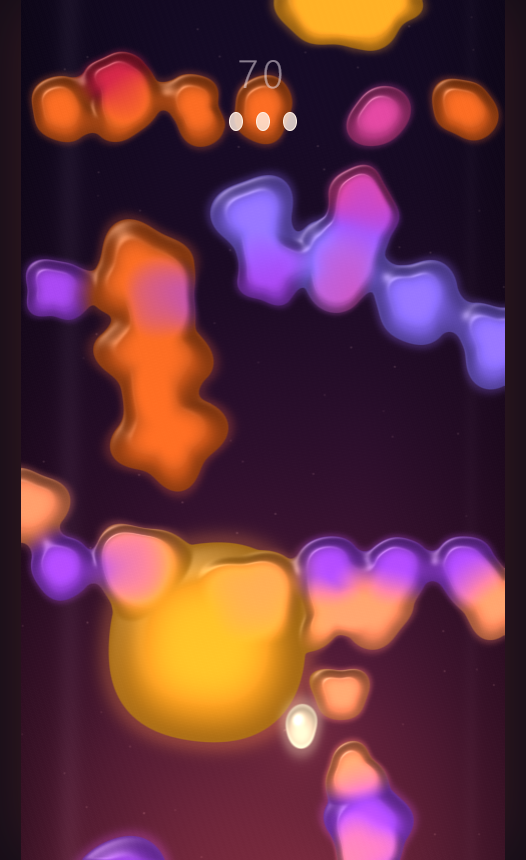

# Molten

A slow, glowing dodge through a lava lamp.

Warm wax drifts down through the dark. It wobbles, swells and melts into itself. You're a small blob of hot wax, and all you have to do is not touch any of it. There are no levels and no lives. Your score is how long you last.

**Play it in your browser:** https://warthreat.itch.io/molten



## Controls

| | Phone | Computer |
|---|---|---|
| Drift | Drag anywhere | W A S D or arrow keys |
| Push nearby wax away | Double tap | Space |
| Mute | | M |

You hold three pushes. They recharge slowly.

## Running locally

You need [Node.js](https://nodejs.org/).

```sh
npm install
npm run dev
```

Then open the URL that Vite prints.

| Command | What it does |
|---|---|
| `npm run dev` | Starts the dev server with hot reload |
| `npm run build` | Builds the game into `dist/` |
| `npm run preview` | Serves the built game from `dist/` |
| `npm run release` | Builds, then zips `dist/` into `molten.zip` for itch.io |

## How it's made

- Rendered with [three.js](https://threejs.org/).
- The music and visuals are generated live in the browser. There are no audio samples or video files.
- Tunable values (speeds, sizes, timings) are in [`src/config.js`](src/config.js).
- [`GAME_DESIGN.md`](GAME_DESIGN.md) describes the full design: gameplay rules, visuals and audio.
